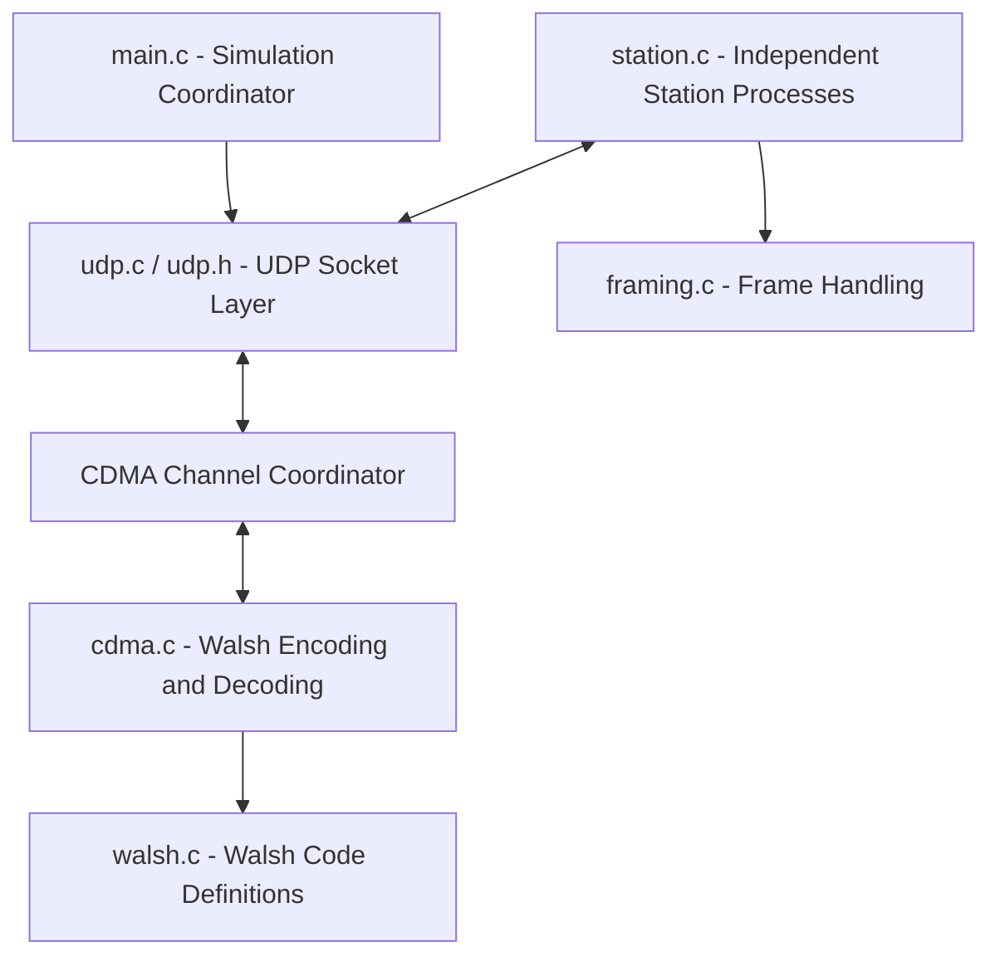

# CDMA Simulation — UDP Socket Implementation

A process-based MAC layer simulation of **CDMA (Code Division Multiple Access)** using unique orthogonal codes generated from a **Walsh (Hadamard) set**, implemented with **UDP sockets** for inter-process communication.

This project replaces the contention-based CSMA protocols from Assignment 3 with a code-division multiple access architecture while preserving the core simulation process synchronization, slot coordination, and UDP socket IPC.

---

## 1. Features

- **Unique Orthogonal Walsh Codes**: Automatically generates Hadamard/Walsh matrices of dimension $M \ge N$ (powers of 2 up to 64). Each station $i$ is assigned a unique row $W_i$.
- **Orthogonality Verification**: Automatically verifies $\sum_{k=0}^{M-1} W_i[k] W_j[k] = 0$ for all $i \ne j$ and $M$ for $i = j$ before simulation start.
- **Physical Channel Simulation**:
  - **Spreading**: Stations/channel spread frame bits using the assigned bipolar Walsh chips ($+1 / -1$).
  - **Superposition**: Simultaneous transmissions are combined via chip-by-chip algebraic summation: $C = \sum_{i} S_i$.
  - **Despreading**: Destination separation is achieved via inner-product correlation: $(C \cdot W_i) / M = d_i$.
- **Zero Contention Collisions**: Simultaneous transmissions share the channel concurrently without destructive interference.
- **Full Process Synchronization**: Multi-process simulation using `fork()` for station nodes and a central coordinator process.
- **Dual UDP Socket Architecture**:
  - Separate UDP Control socket per station (`47000 + i`) for slot status, requests, and results.
  - Separate UDP Data socket per station (`48000 + i`) for payload frame forwarding and receipt.
  - Channel coordinator listening on `46000`.
- **Slotted Coordination**: Synchronized time slots with request collection window, result delivery, and metrics aggregation.
- **Ethernet-Style Framing & Integrity**: 6-byte header, variable payload, 4-byte CRC-32 FCS.
- **High Multi-User Throughput**: Demonstrates how CDMA achieves throughput scaling linearly with the number of active stations ($S \approx N \times p$), unlike CSMA where collisions cause throughput collapse.

---

## 2. Architecture & Communication Flow



### Communication Sequence per Slot:
1. **Slot Start**: Channel coordinator broadcasts `UDP_MSG_SLOT_STATUS` to each station's control port.
2. **Transmission Request**: Transmitting stations send `UDP_MSG_TX_REQUEST` with their serialized frame to the channel coordinator during the collection window (`REQUEST_WINDOW_US = 5000us`).
3. **Channel Superposition & Despreading**:
   - The channel coordinator spreads active frames using station Walsh codes $W_i$.
   - Combines active chip sequences into a composite signal $C$.
   - Despreads $C$ for each station using $W_i$, validates frame integrity, and reconstructs each packet.
4. **Slot Results**: Channel transmits `UDP_MSG_SLOT_RESULT` (success = 1, collision = 0) to all transmitting stations.
5. **Frame Forwarding**: Channel forwards decoded frames via `UDP_MSG_FRAME_DATA` to destination stations' data ports (`48000 + dest`).
6. **Data Reception**: Destination RX threads receive and deserialize incoming frames, verifying the CRC-32 checksum.
7. **Metrics**: Stations report transmission delay via `UDP_MSG_METRIC`.

---

## 3. Mathematical Principle of Walsh Codes in CDMA

Walsh codes are generated using Sylvester's Hadamard matrix recursion:

$$H_1 = [1]$$

$$H_2 = \begin{bmatrix} +1 & +1 \\ +1 & -1 \end{bmatrix}$$

$$H_{2k} = \begin{bmatrix} H_k & H_k \\ H_k & -H_k \end{bmatrix}$$

Or closed-form entry for row $i$ and column $j$:

$$H(i, j) = (-1)^{\text{popcount}(i \land j)}$$

### Orthogonality Property:

For any two stations $i$ and $j$ with code length $M$:

$$\sum_{k=0}^{M-1} W_i[k] \cdot W_j[k] = \begin{cases} M, & i = j \\ 0, & i \ne j \end{cases}$$

### Despreading Composite Signal:

When $K$ active stations transmit data bits $d_k \in \{+1, -1\}$ simultaneously, the composite channel signal is:

$$C = \sum_{k=1}^K d_k W_k$$

To decode station $m$'s transmission:

$$\frac{C \cdot W_m}{M} = \frac{\left(\sum_{k=1}^K d_k W_k\right) \cdot W_m}{M} = \frac{d_m (W_m \cdot W_m) + \sum_{k \ne m} d_k (W_k \cdot W_m)}{M} = \frac{d_m \cdot M + 0}{M} = d_m$$

All cross-terms vanish to zero due to mutual orthogonality.

---

## 4. Comparison: CSMA vs. CDMA

| Characteristic | CSMA (Assignment 3) | CDMA (Assignment 4) |
| :--- | :--- | :--- |
| **Medium Access** | Contention-based (Carrier Sensing) | Code-division (Orthogonal Codes) |
| **Concurrent Transmissions** | Causes collision, all packets lost | Allowed, separated via despreading |
| **Channel State** | IDLE, BUSY (1 station), COLLISION (>1) | IDLE (0 stations), ACTIVE ($\ge 1$ stations) |
| **Collision Rate** | High under heavy load | 0 with orthogonal Walsh set |
| **Max System Throughput** | $< 1.0$ frame/slot (collapses at high $N$) | $\approx N \times p$ frames/slot (scales with $N$) |
| **Delay Under Heavy Load** | High due to exponential backoff | Minimal (no backoff needed) |

---

## 5. Building and Running

### Prerequisites
- GCC supporting C11 and POSIX threads (`-pthread`)
- Linux environment

### Build
```bash
make
```

### Run Simulation
```bash
./cdma_udp_sim <stations> <slots> [p]
```

- `<stations>`: Number of participating stations ($2 \le N \le 50$).
- `<slots>`: Number of simulation slots (e.g., $50, 100, 1000$).
- `[p]`: Optional transmission probability / load ($0.0 \le p \le 1.0$, default is `1.0` for saturated traffic).

### Example: Saturated Load ($p = 1.0$)
```bash
./cdma_udp_sim 4 10 1.0
```

### Example: Probabilistic Traffic ($p = 0.5$)
```bash
./cdma_udp_sim 5 50 0.5
```

---

## 6. Running Experiments & Plotting

To run parameter sweeps across traffic loads and station counts:

```bash
chmod +x run_experiments.sh
./run_experiments.sh
```

To plot throughput and delay curves:

```bash
python3 plot_results.py
```

Generated plots will be saved in `experiments/graphs/`.
